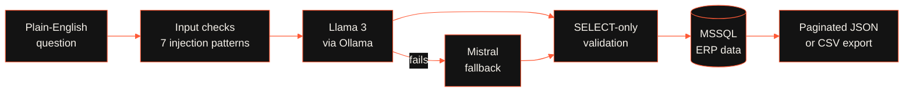

<!-- ═══════════════ HEADER ═══════════════ -->
<div align="center">


<a href="https://aghar-portfolio.vercel.app">
  
</a>

<br/>


<br/><br/>

[](https://aghar-portfolio.vercel.app)
[](https://aghar-portfolio.vercel.app/resume.pdf)
[](https://www.linkedin.com/in/aghar-usmankt/)
[](mailto:agharusman529@gmail.com)


</div>

<br/>

<!-- ═══════════════ ABOUT ═══════════════ -->
## about

I'm a **software developer** who works across the **front end, the backend and AI**. I like owning a feature from the database all the way to the pixel: designing the API, wiring up the data, building the interface and shipping it live.

Over the last year I've built **Python REST services and ETL pipelines** during an internship, an **LLM-powered Text-to-SQL assistant** with real security guardrails, a **computer-vision + IoT** system, and **Next.js sites deployed on Vercel**. I care about code that is reliable, documented and fast.

```python
class Aghar:
    role        = "Software Developer"
    works_on    = ["Front End", "Backend", "AI / LLM Applications"]
    stack       = ["Python", "TypeScript", "React", "Next.js", "FastAPI", "PostgreSQL"]
    education   = "B.E. Information Science & Engineering (2025)"
    strengths   = ["Debugging", "Data validation", "Clear documentation", "Learning fast"]
    open_to     = ["Full-stack", "Backend", "AI engineering"]
    motto       = "Let's build something extraordinary together."
```

<br/>

<!-- ═══════════════ METRICS ═══════════════ -->
## impact in numbers

<div align="center">


</div>

<br/>

<!-- ═══════════════ TECH STACK ═══════════════ -->
## stack

### front end
<p>


</p>
<sub>Responsive layouts · Light/dark theming · Page transitions & scroll animation · Typed content configs · Vercel deployments</sub>

### backend & apis
<p>

</p>
<sub>REST APIs · Microservices · Token-based auth · Rate limiting · Thread-pool concurrency · Pagination · CSV export</sub>

### ai & llms
<p>


</p>
<sub>LLM integration · Text-to-SQL · Prompt engineering · Llama 3 · Mistral · BERT · Transformers · NLTK · spaCy · Computer vision</sub>

### databases & data
<p>


</p>
<sub>Joins · CTEs · Subqueries · ETL pipelines · Data validation · psycopg2 · pyodbc</sub>

### tools & cloud
<p>

</p>
<sub>CI/CD · Docker · Linux/Unix · Google Cloud · Vercel</sub>

<br/>

<!-- ═══════════════ PROJECTS ═══════════════ -->
## projects

<table>
<tr>
<td width="50%" valign="top">

### AI Text-to-SQL Assistant
*Built at Team Thai · Feb–May 2025*

Lets business users query an **MSSQL ERP sales database in plain English**, powered by **Llama 3 + Mistral via Ollama**.

- Dual-model fallback, 3-attempt retry, thread-safe TTL cache
- **SELECT-only** enforcement + **7-pattern** SQL-injection detection
- Flask REST API with pagination (10–500 rows) and CSV export, **~35% faster** responses

`Python` `Flask` `Ollama` `Llama 3` `Mistral` `MSSQL`

</td>
<td width="50%" valign="top">

### AgriLeaf Pro
*Plant disease detection with IoT · 2024–2025*

A **5-layer CNN** that classifies **19 diseases across 4 crops** with **85%+ accuracy** and **sub-100 ms** inference.

- Flask API with OpenCV preprocessing, token-based auth and automated treatment recommendations
- ThingSpeak IoT pipeline streaming **6 real-time soil parameters** with 7-day history charts

`Python` `TensorFlow` `Flask` `OpenCV` `ThingSpeak` `GCP`

[**View repo →**](https://github.com/aghar-usman/Leaf-Disease-Detection-using-CNN)

</td>
</tr>
<tr>
<td width="50%" valign="top">

### SU·EN Studio
*Website for an architecture & design studio in Kerala and Bangalore · 2026*

A responsive **Next.js (App Router) + TypeScript** site where every project page is generated from a **single typed data file**.

- Full-screen image galleries with page transitions and scroll animation (Framer Motion + GSAP)
- Light/dark theme, contact form, mobile-to-desktop layout
- Auto-deployed on **Vercel** from GitHub

`Next.js` `TypeScript` `Tailwind` `Framer Motion` `GSAP`

[**View live →**](https://suen-studio.vercel.app/)

</td>
<td width="50%" valign="top">

### Developer Portfolio
*Personal site · 2026*

A single-page portfolio that renders stack, experience, projects and education from **one typed content config**.

- Anchor navigation, resume download and contact links
- Live at [aghar-portfolio.vercel.app](https://aghar-portfolio.vercel.app)

`Next.js` `React` `TypeScript` `Tailwind` `Vercel`

</td>
</tr>
</table>

<br/>

<!-- ═══════════════ ARCHITECTURE ═══════════════ -->
## how my text-to-sql assistant works



<br/>

<!-- ═══════════════ EXPERIENCE ═══════════════ -->
## experience

| Role | Where | When |
|:--|:--|:--|
| **Python Backend Intern** — REST APIs, LLM tooling, PostgreSQL ETL | **Team Thai**, Calicut, Kerala | Feb 2025 – May 2025 |

<details>
<summary><b>What I shipped there</b></summary>
<br/>

- Built a Flask REST API with a thread-pool executor, configurable pagination (10–500 rows) and CSV export, cutting query response time by ~35% through caching and batch fetching
- Designed a text-to-SQL chatbot with Llama 3 and Mistral (via Ollama), dual-model fallback, 3-attempt retry logic and thread-safe TTL caching
- Engineered SQL-injection prevention with 7-pattern regex detection and SELECT-only enforcement over an MSSQL sales database
- Implemented a PostgreSQL ETL pipeline for a 22-column customer schema with 100-row batch insertion, per-row retry, timestamp normalization and automated failed-row reporting

</details>

<br/>

<!-- ═══════════════ GITHUB STATS ═══════════════ -->
## github stats

<div align="center">


<br/>


<br/>


</div>

<br/>

<!-- ═══════════════ EDUCATION ═══════════════ -->
## education & achievements

- **B.E. in Information Science & Engineering**, Malnad College of Engineering, Hassan (VTU) · 2021–2025 · **CGPA 7.81 / 10** (First Class with Distinction)
- **State-Level Hackathon, 2nd Place**: led a 4-member team, owned the backend architecture, coordinated the task split and delivered a working product in **6 hours**
- **Coursework:** DBMS · Operating Systems · Computer Networks · Software Engineering · Artificial Intelligence · Machine Learning · Big Data Technologies · Data Science Using R · Information Storage & Management

<br/>

<!-- ═══════════════ CLOSING ═══════════════ -->
<div align="center">

## Let's build something extraordinary together.

Open to **full-stack**, **backend** and **AI engineering** roles, and happy to collaborate on full-stack web apps, LLM-powered tools and agents, data-driven backend platforms, and end-to-end deployment (model → API → UI).

<br/>

[](https://aghar-portfolio.vercel.app)
[](https://aghar-portfolio.vercel.app/resume.pdf)
[](https://www.linkedin.com/in/aghar-usmankt/)
[](mailto:agharusman529@gmail.com)

<br/>

<sub>© 2026 · Engineered with precision.</sub>


</div>

<!-- Proudly created by Aghar Usman -->
