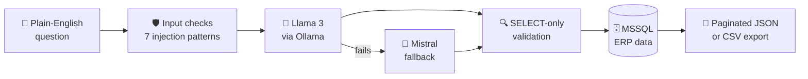

<!-- ═══════════════ HEADER ═══════════════ -->
<div align="center">


<a href="https://git.io/typing-svg">
  
</a>

<br/>

[](https://aghar-portfolio.vercel.app)
[](https://www.linkedin.com/in/aghar-usmankt/)
[](mailto:agharusman529@gmail.com)


</div>

<br/>

<!-- ═══════════════ ABOUT ═══════════════ -->
## 👨‍💻 About Me

I'm a **software developer** who works across the **front end, the backend and AI**. I like owning a feature from the database all the way to the pixel: designing the API, wiring up the data, building the interface and shipping it live.

Over the last year I've built **Python REST services and ETL pipelines** during an internship, an **LLM-powered Text-to-SQL assistant** with real security guardrails, a **computer-vision + IoT** system, and **Next.js sites deployed on Vercel**. I care about code that is reliable, documented and fast.

```python
class Aghar:
    role     = "Software Developer"
    works_on = ["Front End", "Backend", "AI / LLM Applications"]
    stack    = ["Python", "TypeScript", "React", "Next.js", "FastAPI", "PostgreSQL"]
    education = "B.E. Information Science & Engineering (2025)"
    strengths = ["Debugging", "Data validation", "Clear documentation", "Learning fast"]
    open_to   = ["Full-stack", "Backend", "AI engineering"]
```

<br/>

<!-- ═══════════════ METRICS ═══════════════ -->
## 📊 Impact in Numbers

<div align="center">

| ⚡ **~35%** | 🎯 **85%+** | 🚀 **<100 ms** | 🏆 **2nd Place** |
|:---:|:---:|:---:|:---:|
| faster API response via caching & batch fetching | CNN accuracy across **19 diseases** on **4 crops** | model inference time | State-level hackathon, built in **6 hours** |

| 🛡️ **7** | 🔁 **3×** | 🗄️ **22 cols** | 🎓 **7.81 CGPA** |
|:---:|:---:|:---:|:---:|
| SQL-injection patterns detected & blocked | retry attempts + dual-model fallback | PostgreSQL ETL schema, **100-row** batches | First Class with Distinction |

</div>

<br/>

<!-- ═══════════════ TECH STACK ═══════════════ -->
## 🛠️ Tech Stack

### 🎨 Front End
<p>


</p>

### ⚙️ Backend & APIs
<p>

</p>
<sub>REST APIs · Token-based auth · Rate limiting · Thread-pool concurrency · Pagination · CSV export</sub>

### 🗄️ Databases & Data
<p>


</p>
<sub>Joins · CTEs · Subqueries · ETL pipelines · Data validation</sub>

### 🤖 AI & LLMs
<p>


</p>
<sub>LLM integration · Text-to-SQL · Prompt engineering · Llama 3 · Mistral · Computer vision</sub>

### ☁️ Tools & Cloud
<p>

</p>
<sub>CI/CD · Docker · Linux · Google Cloud · Vercel</sub>

<br/>

<!-- ═══════════════ PROJECTS ═══════════════ -->
## 🚀 Featured Projects

<table>
<tr>
<td width="50%" valign="top">

### 🧠 AI Text-to-SQL Assistant
*Built at Team Thai · Feb–May 2025*

Lets business users query an **MSSQL ERP sales database in plain English**, powered by **Llama 3 + Mistral via Ollama**.

- 🔁 Dual-model fallback, 3-attempt retry, thread-safe TTL cache
- 🛡️ **SELECT-only** enforcement + **7-pattern** SQL-injection detection
- ⚡ Flask REST API with pagination (10–500 rows) and CSV export, **~35% faster** responses

`Python` `Flask` `Ollama` `Llama 3` `Mistral` `MSSQL`

</td>
<td width="50%" valign="top">

### 🌿 AgriLeaf Pro
*Plant disease detection with IoT · 2024–2025*

A **5-layer CNN** that classifies **19 diseases across 4 crops** with **85%+ accuracy** and **sub-100 ms** inference.

- 🔐 Flask API with OpenCV preprocessing and token-based auth
- 📡 ThingSpeak IoT pipeline streaming **6 real-time soil parameters** with 7-day history charts

`Python` `TensorFlow` `Flask` `OpenCV` `ThingSpeak` `GCP`

</td>
</tr>
<tr>
<td width="50%" valign="top">

### 🏛️ SU·EN Studio
*Architecture studio website · 2026*

A responsive **Next.js (App Router) + TypeScript** site where every project page is generated from a **single typed data file**.

- 🖼️ Image galleries, animations, light/dark theme, contact form
- 🚢 Auto-deployed on **Vercel** from GitHub

`Next.js` `TypeScript` `Tailwind` `Framer Motion` `GSAP`

</td>
<td width="50%" valign="top">

### 🌐 Developer Portfolio
*Personal site · 2026*

A single-page portfolio that renders stack, experience, projects and education from **one typed content config**.

- ⚓ Anchor navigation and resume download
- 🔗 Live at [aghar-portfolio.vercel.app](https://aghar-portfolio.vercel.app)

`Next.js` `React` `TypeScript` `Tailwind` `Vercel`

</td>
</tr>
</table>

<br/>

<!-- ═══════════════ ARCHITECTURE ═══════════════ -->
## 🧩 How My Text-to-SQL Assistant Works



<br/>

<!-- ═══════════════ EXPERIENCE ═══════════════ -->
## 💼 Experience

| Role | Where | When |
|:--|:--|:--|
| **Software Developer Intern** — Python backend, REST APIs, LLM tooling, PostgreSQL ETL | **Team Thai**, Calicut, Kerala | Feb 2025 – May 2025 |

<details>
<summary><b>📌 What I shipped there</b></summary>
<br/>

- Built an AI Text-to-SQL assistant for an ERP with dual-model fallback, retry logic and TTL caching
- Hardened it with SELECT-only enforcement and SQL-injection detection to protect live business data
- Developed a Flask REST API with thread-pool concurrency, pagination and CSV export, cutting response time by ~35%
- Designed a PostgreSQL ETL pipeline for a 22-column schema with 100-row batch loading, timestamp normalization, per-record retry and automated failed-record reports

</details>

<br/>

<!-- ═══════════════ GITHUB STATS ═══════════════ -->
## 📈 GitHub Stats

<div align="center">


<br/>


<br/>


</div>

<br/>

<!-- ═══════════════ EDUCATION ═══════════════ -->
## 🎓 Education & Achievements

- 🎓 **B.E. in Information Science & Engineering**, Malnad College of Engineering, Hassan (VTU) · 2021–2025 · **CGPA 7.81 / 10** (First Class with Distinction)
- 🏆 **State-Level Hackathon, 2nd Place**: led a 4-member team, owned the backend architecture and delivered a working product in **6 hours**
- 📚 **Coursework:** Data Structures & Algorithms · DBMS · Operating Systems · Computer Networks · Software Engineering · Machine Learning

<br/>

<!-- ═══════════════ COLLAB ═══════════════ -->
## 🤝 Let's Build Something

I'm open to **full-stack**, **backend** and **AI engineering** roles, and happy to collaborate on:

- 🌐 Full-stack web apps (Next.js + Python APIs)
- 🤖 LLM-powered tools and agents
- 📊 Data-driven backend platforms
- ⚙️ End-to-end deployment (model → API → UI)

<div align="center">

<br/>

[](https://aghar-portfolio.vercel.app)
[](https://www.linkedin.com/in/aghar-usmankt/)
[](mailto:agharusman529@gmail.com)


</div>

<!-- Proudly created by Aghar Usman -->
